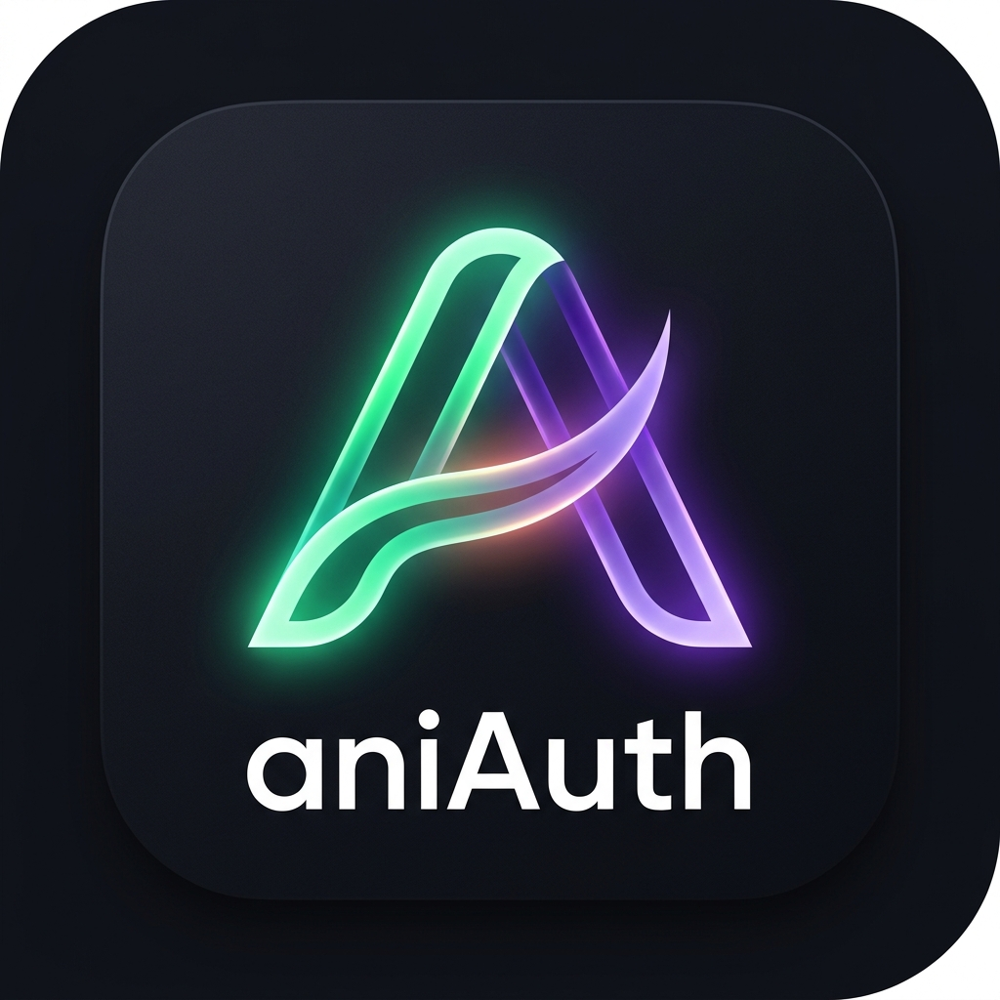

<p align="center">
  
</p>

<h1 align="center">aniAuth</h1>

<p align="center">
  <strong>A TOTP authenticator for Android and Wear OS.</strong>
</p>

<p align="center">
  <a href="https://github.com/anishcreations/aniAuth/releases/tag/v1.8.0"></a>
  <a href="https://github.com/anishcreations/aniAuth/releases/tag/wear-v1.3.0"></a>
</p>

<p align="center">
  Generate two-factor codes on your phone and watch. Accounts stay on your devices, with secrets encrypted through Android KeyStore.
</p>

---

> [!NOTE]
> For the overall release log, see [CHANGELOG.md](CHANGELOG.md). Wear OS features, setup, security, and the [independent watch changelog](WEAROS.md#changelog) are documented in [WEAROS.md](WEAROS.md). Latest releases: **phone 1.8.0** and **watch 1.3.0**.

## Table of Contents

- [Features](#features)
- [Wear OS Companion App](WEAROS.md)
- [Security and Threat Model](#security-and-threat-model)
- [Codebase Structure](#codebase-structure)
- [Compatibility and Imports](#compatibility-and-imports)
- [How It Works Under the Hood](#how-it-works-under-the-hood)
- [Build and Installation](#build-and-installation)
- [Contact and Feedback](#contact-and-feedback)
- [License](#license)

---

## Features

### Account Setup

- **QR Scanner**: Scan account QR codes using Google ML Kit. The scanning model is provided through Google Play Services rather than bundled in the APK.
- **Manual Entry**: Add secret keys with custom labels and names, with field validation.

### Security

- **Local Encryption**: Secrets are encrypted with an Android KeyStore key. Hardware backing through a Trusted Execution Environment (TEE) or Secure Element (SE) depends on the device.
- **Biometric & Device Lock**: Optional app lock using Android-supported Class 2 or stronger face/fingerprint authentication or device PIN, pattern, or password. Enabling app lock requires successful verification; cancelling leaves it disabled. Face recognition must be exposed through Android's biometric API.
- **Protected Keys & Deletion**: Identity verification is required before revealing or copying secret keys, or deleting an account. Cancellation, errors, and prompt exceptions keep protected actions blocked.
- **Prevent Screenshots & Recents Preview (`FLAG_SECURE`)**: User-configurable toggle in Settings that enforces `FLAG_SECURE`, blocking screen captures and obscuring app previews in the Android Recent Apps switcher.
- **Offline Codes**: Code generation works offline, and the app does not request internet permission. Google Play Services may download the QR scanning model separately.

### Wear OS Integration

- **Protected Watch Sync**: Transfer accounts through the Wear OS Data Layer after face/fingerprint or device-credential verification. The phone and watch must be paired through their Wear OS companion setup; a Bluetooth connection alone does not establish the app's sync connection.
- **Customizable Duress PIN**: Configure the maximum allowed PIN attempts (e.g., 3, 6, 9, or unlimited) on your watch directly from the phone app. If the limit is exceeded, all watch accounts are silently wiped to protect your data.

### Interface and Account Management

- **Themes**: Choose light, dark, or system appearance in Settings.
- **Account Sorting**: Sort by date added or alphabetically (A–Z or Z–A). Your selection is saved.
- **Alphabet Sidebar**: Move through accounts using the right-hand sidebar, with letter magnification, haptic feedback, and a preview bubble. It stays faint when idle.
- **Settings**: Manage themes, backups, imports, app security, and guides in one place.
- **In-App Manual**: Read about controls, the shared code timer, KeyStore encryption, backup formats, and Wear OS sync and offline use.
- **Integrated Search & Timer**: Search and the shared countdown sit together in a compact header. The refresh message switches to a focused search field on demand.
- **One-Tap Copy**: Tap any card to copy the code directly to your clipboard. Turn this off under Settings → Interaction → Tap to Copy Codes.
- **Backup Exports**: Export encrypted backups using the built-in backup password, or plaintext JSON. Both require identity verification; plaintext exports include a warning.
- **Account Management**: Long-press any card to securely view decrypted secret keys, edit account metadata, or delete credentials.
- **Adaptive Launcher Icon**: A geometric “A” icon with support for adaptive Android launcher shapes.
- **Minimal Scroll Hints**: Static, theme-aware down-arrow indicators and subtle fades on scrollable dialogs and lists show when more content is available.

---

## Security and Threat Model

### 1. Data Encryption (At Rest)
All account data is stored locally in `SharedPreferences`. The raw shared secrets are encrypted using the AES/GCM/NoPadding cipher.
* **Key Generation**: A 256-bit AES master key is generated inside the Android KeyStore using the `KeyGenParameterSpec` builder with GCM block mode and no padding.
* **Key Isolation**: Android KeyStore keeps the master key non-exportable. Hardware backing (TEE/SE) depends on the device.
* **Payload Encryption**: For each account, the secret is encrypted with a unique initialization vector (IV). The IV (12 bytes) and cipher text are combined, Base64-encoded, and saved to disk.

### 2. Encrypted Backups
Encrypted backups use key derivation and GCM encryption. The current app uses a built-in backup password, not a user-chosen password; this does not offer the same protection as a private password.
* **Key Derivation (KDF)**: A 256-bit AES key is derived from the backup password using **PBKDF2WithHmacSHA256** with 10,000 iterations and a cryptographically secure 16-byte salt.
* **Encryption**: The JSON payload (with decrypted secrets) is encrypted with the derived key using **AES/GCM/NoPadding** and a secure 12-byte IV.
* **Export Payload**: The exported file is formatted as a Base64 string containing: `salt (16 bytes) + IV (12 bytes) + encrypted payload`.

---

## Codebase Structure

```
aniAuth/
├── app/
│   ├── src/
│   │   ├── main/
│   │   │   ├── java/com/aniauth/authenticator/
│   │   │   │   ├── crypto/
│   │   │   │   │   ├── BackupManager.kt      # Encrypted backup & import engine
│   │   │   │   │   ├── KeyStoreHelper.kt     # Hardware-backed AES encryption (key: AniAuthMasterKey)
│   │   │   │   │   ├── OtpAuthParser.kt      # Parse otpauth:// URIs
│   │   │   │   │   └── TotpGenerator.kt      # RFC 6238 TOTP calculator
│   │   │   │   ├── model/
│   │   │   │   │   ├── Account.kt            # Data model representing a 2FA account
│   │   │   │   │   ├── AccountRepository.kt   # Local storage and CRUD operations
│   │   │   │   │   └── AccountSerializer.kt   # JSON serialization for backup/import
│   │   │   │   ├── ui/
│   │   │   │   │   ├── screens/
│   │   │   │   │   │   ├── AddAccountScreen.kt
│   │   │   │   │   │   ├── BiometricLockScreen.kt
│   │   │   │   │   │   ├── DashboardScreen.kt
│   │   │   │   │   │   ├── ScannerScreen.kt
│   │   │   │   │   │   ├── AccountDetailsScreen.kt
│   │   │   │   │   │   └── SettingsScreen.kt
│   │   │   │   │   └── theme/
│   │   │   │   │       ├── Color.kt
│   │   │   │   │       └── Theme.kt
│   │   │   │   └── MainActivity.kt           # App lifecycle & entry point
│   │   │   └── AndroidManifest.xml
│   └── build.gradle.kts
├── wearos/                                    # Wear OS companion module
│   ├── src/
│   │   ├── main/
│   │   │   ├── java/com/aniauth/authenticator/wearos/
│   │   │   │   ├── crypto/
│   │   │   │   │   ├── KeyStoreHelper.kt     # Watch-local AES encryption (key: AniAuthWatchMasterKey)
│   │   │   │   │   └── TotpGenerator.kt      # Standalone RFC 6238 TOTP calculator
│   │   │   │   ├── model/
│   │   │   │   │   ├── Account.kt            # Watch account data model
│   │   │   │   │   └── WatchRepository.kt    # Watch-local storage with decryption cache
│   │   │   │   ├── sync/
│   │   │   │   │   └── WearSyncService.kt    # Wearable Data Layer message listener
│   │   │   │   └── MainActivity.kt           # Watch UI: PIN lock, keypad, dashboard
│   │   │   └── AndroidManifest.xml
│   └── build.gradle.kts
├── build.gradle.kts
├── settings.gradle.kts
├── CHANGELOG.md
├── WEAROS.md                                  # Wear OS companion documentation
├── LICENSE
└── README.md
```

---

## Compatibility and Imports

aniAuth supports one-way imports from these formats:
* **Bitwarden Vault Exports**: Import Bitwarden's JSON vaults directly. The app will extract TOTP secrets from the standard `login.totp` field nested inside items.
* **Other JSON Formats**: The importer automatically parses common properties like `secret`, `key`, `encryptedSecret`, `label`, `name`, `issuer`, and `username` to build the credentials list.
* **Local Encryption on Import**: Plaintext secrets are parsed, encrypted with the device's KeyStore key, and then saved locally.

---

## How It Works Under the Hood

### 1. Account Storage & Encryption Pipeline
When you add an account (via QR scan, manual entry, or import), the following happens:

1. **Secret Extraction**: The raw Base32 secret is extracted from the `otpauth://` URI (via `OtpAuthParser`) or from the manual entry form.
2. **Immediate Encryption**: The plaintext secret is passed to `KeyStoreHelper.encrypt()` *before* it ever touches disk. A 256-bit AES master key (alias: `AniAuthMasterKey`) stored in Android KeyStore performs AES-GCM encryption. Hardware backing depends on the device. The system generates a cryptographically random 12-byte IV for each encryption operation.
3. **Combined Payload**: The IV (12 bytes) and ciphertext are concatenated into a single byte array and Base64-encoded (using `Base64.NO_WRAP`).
4. **Disk Write**: The Base64-encoded blob is saved as the `encryptedSecret` field inside a JSON array stored in `SharedPreferences` (file: `ani_auth_prefs`). The plaintext secret is never written to disk.
5. **Decryption Cache**: On read, `KeyStoreHelper.decrypt()` uses a thread-safe `ConcurrentHashMap` to cache previously decrypted values in memory only. This avoids repeated hardware KeyStore calls during UI scrolls and recompositions, reducing work during scrolling and recomposition.

### 2. RFC 6238 TOTP Code Generation
The `TotpGenerator` implements the standard TOTP algorithm:

1. The Base32-encoded secret is cleaned (whitespace/hyphens stripped, uppercased) and decoded into raw bytes using a custom Base32 decoder.
2. The current Unix epoch (seconds) is divided by the time interval (default: **30 seconds**) to compute the current time step.
3. The time step is packed into an **8-byte big-endian `ByteBuffer`**.
4. An **HMAC-SHA1** hash is computed over the time step bytes using the decoded secret as the MAC key.
5. **Dynamic truncation**: The last 4 bits of the 20-byte HMAC hash determine an offset. A 4-byte segment is extracted starting at that offset, with the high bit masked off (`& 0x7f`).
6. The 31-bit integer is reduced to 6 digits via `binary % 1,000,000` and zero-padded with `String.format("%06d", otp)`.

### 3. Backup Export Mechanics
aniAuth offers two export formats, both requiring biometric/device credential verification first:

#### Encrypted Backup
1. `AccountSerializer.toJson(accounts, decryptSecrets = true)` decrypts every account secret from the KeyStore so the backup contains portable, plaintext Base32 keys.
2. The JSON payload is encrypted by `BackupManager.encrypt()` using a hardcoded internal backup password:
   - A **16-byte cryptographic salt** is generated via `SecureRandom`.
   - A **256-bit AES key** is derived from the password using **PBKDF2WithHmacSHA256** with **10,000 iterations**.
   - A **12-byte IV** is generated via `SecureRandom`.
   - The JSON is encrypted with **AES/GCM/NoPadding** using a **128-bit authentication tag**.
3. The output file contains: `Base64(salt[16] + IV[12] + ciphertext)`.

#### Decrypted Backup
1. The same `toJson(decryptSecrets = true)` call produces portable JSON.
2. The raw JSON is written directly to the `.json` file with no additional encryption.

### 4. Import Pipeline & Compatibility
The `AccountSerializer.fromJson()` parser handles multiple formats:

1. **aniAuth native format**: Direct JSON array of `{id, label, encryptedSecret, username}` objects.
2. **Bitwarden Vault exports**: Detects `items[]` → `login.totp` nested structure, parses `otpauth://` URIs via `OtpAuthParser`.
3. **Universal fallback**: Searches for common field names (`secret`, `key`, `encryptedSecret`, `name`, `label`, `issuer`, `username`) and auto-extracts credentials.
4. **Re-encryption**: On import, `MainActivity` validates each secret via `TotpGenerator.isValidSecret()`, encrypts valid keys with the device's KeyStore, and skips invalid/un-decodable entries (reporting the skip count to the user).

### 5. Wear OS Sync Flow
> For full details on the watch companion module, see [WEAROS.md](WEAROS.md).

1. The phone app queries `Wearable.getNodeClient()` to detect connected watches. The "Sync to Watch" settings row only appears when a paired node is found.
2. On tap, face/fingerprint or device-credential verification is required. After verification, `AccountSerializer.toJson(accounts, decryptSecrets = true)` produces a JSON payload with plaintext Base32 secrets.
3. The payload is transmitted via `Wearable.getMessageClient().sendMessage()` over the `/sync-accounts` path through the Wear OS Data Layer.
4. On the watch, `WearSyncService` (a `WearableListenerService`) receives the message, validates each secret via `TotpGenerator.isValidSecret()`, re-encrypts each key using the **watch's own independent KeyStore master key** (alias: `AniAuthWatchMasterKey`), and saves the encrypted accounts to the watch's local `SharedPreferences`.
5. The watch then generates TOTP codes independently using its own local clock and its own copy of `TotpGenerator` — no phone connection required after the initial sync.

## Build and Installation

### Pre-built Downloads
Download published APKs from GitHub Releases:
* **Android Phone App**: [aniAuth-v1.8.0.apk](https://github.com/anishcreations/aniAuth/releases/tag/v1.8.0)
* **Wear OS Companion App**: [aniAuth-wear-v1.3.0.apk](https://github.com/anishcreations/aniAuth/releases/tag/wear-v1.3.0) — *(See [Watch Installation & Sideloading Guide](WEAROS.md#watch-installation-guide))*

### Prerequisites

* **JDK 17** or higher
* **Android SDK** (API 26+)
* **Android Studio Koala (or newer)** or command-line tools

### Building from Source

1. Clone the repository:
   ```bash
   git clone https://github.com/anishcreations/aniAuth.git
   cd aniAuth
   ```
2. Build the Debug APK:
   ```bash
   ./gradlew :app:assembleDebug
   ./gradlew :wearos:assembleDebug
   ```
3. Install the APK on a connected device/emulator:
   ```bash
   ./gradlew :app:installDebug
   # Run separately with your watch selected or connected:
   ./gradlew :wearos:installDebug
   ```

## Contact and Feedback

[Email](mailto:anish.creations.hq@gmail.com) · [Website](https://anisharyal09.com.np/#contact) · [GitHub Issues](https://github.com/anishcreations/aniAuth/issues)

---

## License

This project is licensed under the Apache License 2.0 - see the [LICENSE](LICENSE) file for details.
